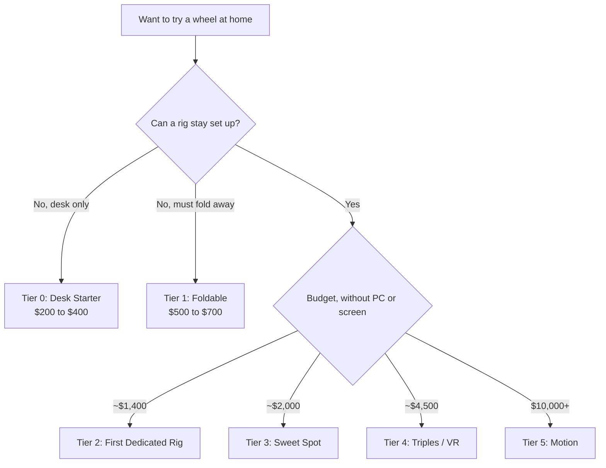

# Sim Racing Equipment Guide

<!-- Draft for you to edit. Facts from research-v2/ (sources there). Prices USD, checked 2026-10. -->

## Start here

| You want | Go to |
|---|---|
| To be driving this week | [Quick Start Guide](start/quick-start.md) |
| To understand it before buying | [Slow Start Guide](start/slow-start.md) |
| A setup for your budget | The chart below |

## Pick a setup

## Types of setups

| Tier | Cost | What it is |
|---|---|---|
| [0: Desk Starter](builds/tier-0-desk-starter.md) | $200 to $400 | Wheel clamped to your desk |
| [1: Foldable / Apartment](builds/tier-1-foldable-apartment.md) | $500 to $700 | Entry direct drive on a seat that folds into a closet |
| [2: First Dedicated Rig](builds/tier-2-first-dedicated-rig.md) | $1,200 to $1,600 | Fixed cockpit, 8 to 9 Nm, load cell brake |
| [3: Sweet Spot Enthusiast](builds/tier-3-sweet-spot-enthusiast.md) | $1,800 to $2,200 | Aluminum rig, 12 Nm, pedals you keep for 10 years |
| [4: Triples / VR Enthusiast](builds/tier-4-triples-vr-enthusiast.md) | $3,500 to $5,500 | Tier 3 plus wraparound screens or VR, shifter, shakers |
| [5: Motion / Pro](builds/tier-5-motion-pro.md) | $10,000 to $18,000 | The rig moves under you |

- Costs exclude PC or console, and the screen until Tier 4
- Each tier page ends with a full example build: parts, prices, links to buy
- Side by side: [Types of Setups](builds/index.md)

## Three decisions, in order

| Decision | Options | Why |
|---|---|---|
| [Platform](components/pc-console.md#choices) | PC, PlayStation or Xbox | It limits which wheels work before budget does |
| [Space](builds/index.md#basic-constraints) | Desk only, fold away, or permanent | It picks the mount |
| [Budget](builds/index.md#the-six-tiers) | $200 to $18,000 | It picks the tier |

## Rules of thumb

- Spend order: direct drive wheelbase first, then a load cell brake, then everything else. See [Buying Smart](start/buying.md#upgrade-order)
- 5 to 8 Nm is plenty to start. 12 Nm is the sweet spot. 10 to 15 Nm covers nearly everyone. See [Wheelbase](components/wheelbases.md#what-matters)
- Direct drive now starts at ~$280 on PC. Skip gear-driven wheels unless used, or on a tight PlayStation budget. See [Wheelbase](components/wheelbases.md#levels)
- Used Logitech G29 at ~$120 resells for ~$120: a free trial. See [Tier 0: Desk Starter](builds/tier-0-desk-starter.md#used-market-alternative)
- PlayStation is the expensive platform at every tier. See [PC / Console](components/pc-console.md#choices)
- Motion and big torque add immersion, not lap time. See [Motion & Immersion](components/immersion.md)

## More

- [What to Play](start/games.md)
- [Buying Smart](start/buying.md)
- [First Setup](start/first-setup.md)
- [Rig Anatomy](components/index.md)
- [Glossary](start/glossary.md)
